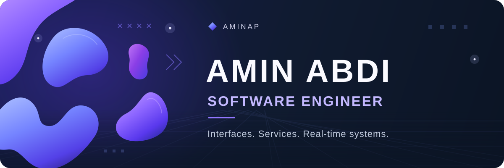

  

# Hi 👋, I'm Amin Abdi

**Software Engineer · Full-stack development · Tehran, Iran**

I'm a software engineer at **Gardoon**, building interfaces and the systems behind them. I started with frontend development, and **React, Next.js, and TypeScript** remain my strongest foundation.

I work on reusable interfaces, real-time application behavior, and backend services. I care about thoughtful design, predictable state, and understanding how a feature works from the screen through the API and data layers.

[Portfolio](https://aminabdi.vercel.app) · [Résumé](https://aminabdi.vercel.app/resume.pdf) · [Technical profile](https://aminabdi.vercel.app/technical-profile.pdf)

## ✅ My Projects

### [Portfolio](https://aminabdi.vercel.app)

My current portfolio, built with Next.js, React, TypeScript, and Tailwind CSS. Explore my work and technical background, with light and dark themes and a contact form.

### Earlier frontend projects

These independent projects are part of my early frontend work:

- **[Amin Store](https://amin-store-xi.vercel.app/)** — A storefront interface exploring commerce layouts and product presentation.
- **[Amin Note](https://amin-note.vercel.app/)** — A Persian note-taking interface for adding, editing, and marking notes as complete.
- **[Amin Movie](https://amin-movie.vercel.app/)** — A movie discovery interface exploring how to present film content on the web.

## 💻 Tech Stack

  

- **Frontend:** TypeScript, JavaScript, React, Next.js, Tailwind CSS, MUI, shadcn/ui, HTML, CSS/SCSS; TanStack Query, Jotai, Redux, Zustand, React Hook Form, Zod, and Yup.
- **Backend:** Node.js, NestJS, REST APIs, JWT/OAuth, authentication, and authorization.
- **Data:** SQL, PostgreSQL, MySQL/MariaDB, MongoDB, Redis, and Prisma.
- **Real-time:** WebSocket, Socket.IO, synchronized state, and embeddable interfaces.
- **Delivery:** Git, Docker, Docker Compose, Linux, Nginx, GitLab CI/CD, PM2, pnpm, Turborepo, and Vite.

## 🌱 Alongside Work

I'm studying for a **B.Sc. in Computer Engineering** at **Islamic Azad University, Islamshahr Branch**.

I'm also learning about **applied AI, LLM-powered applications, and automation** alongside my full-stack work.

## 🤝 Connect

[Email](mailto:aminabdiii2006@gmail.com) · [LinkedIn](https://www.linkedin.com/in/amin-abdi-340273349/) · [Telegram](https://t.me/AminAP9)

  
📊 GitHub Activity

Browse my [contributions](https://github.com/aminabdiii?tab=overview) and [public repositories](https://github.com/aminabdiii?tab=repositories) on GitHub.

